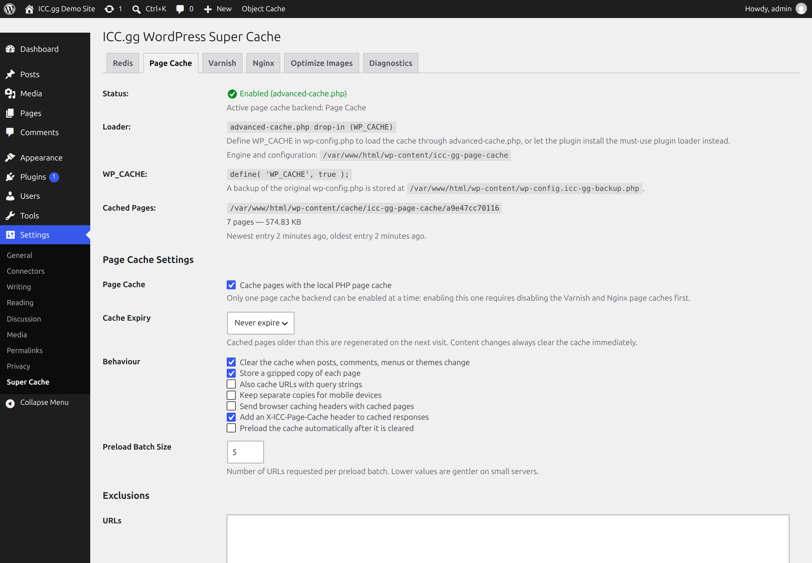
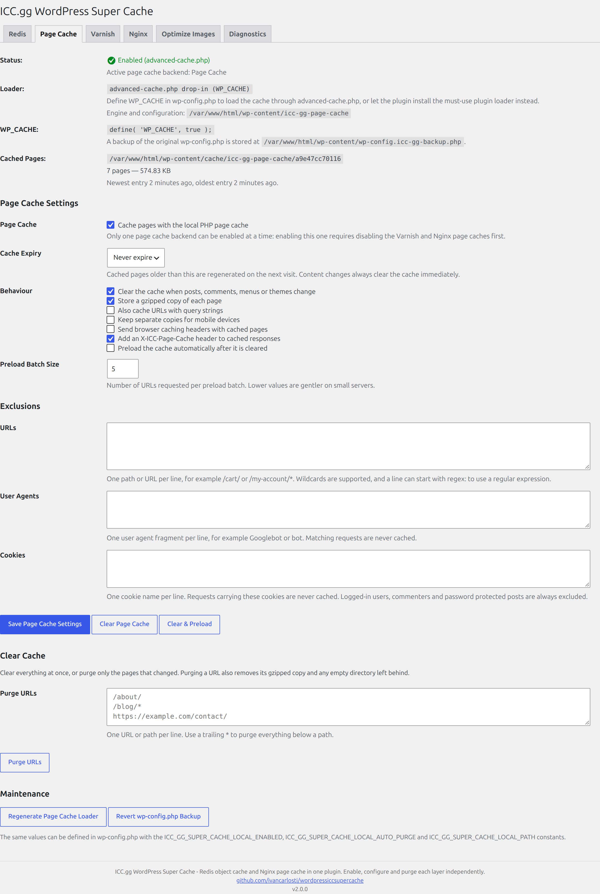
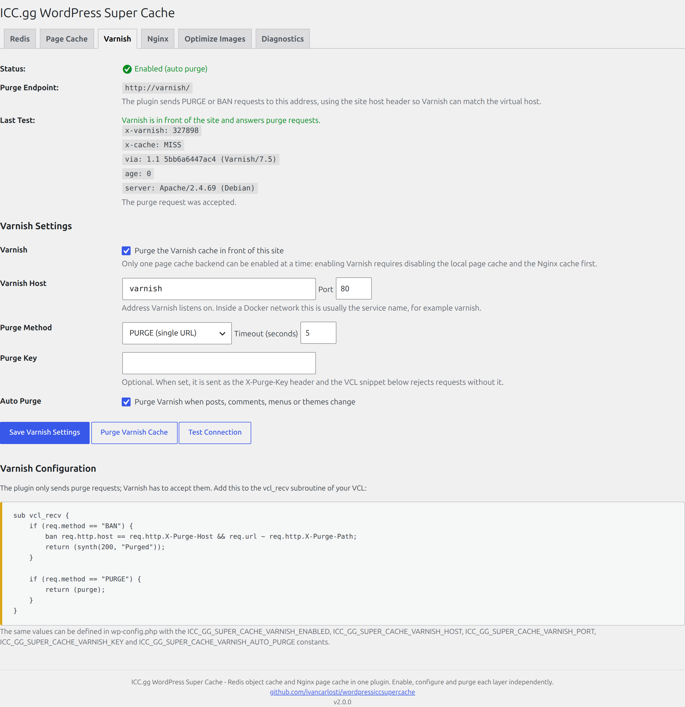
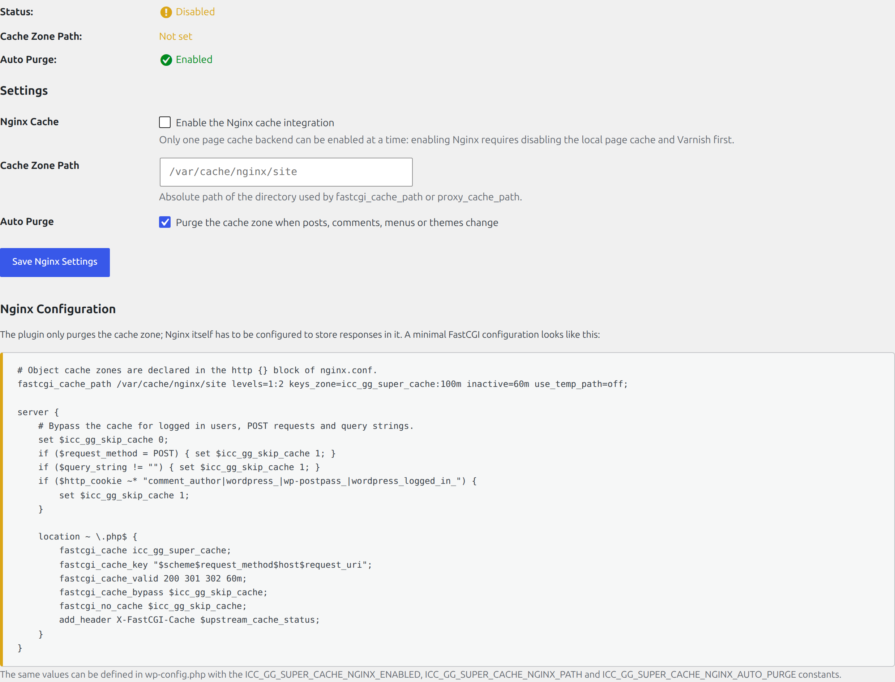
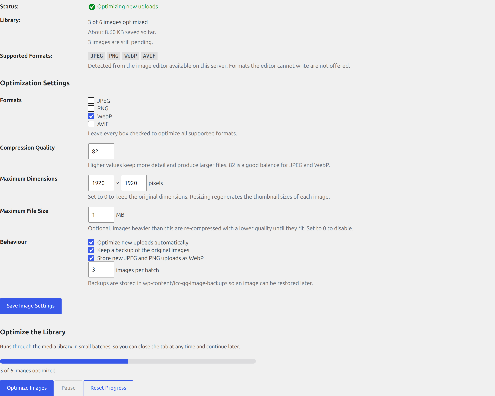
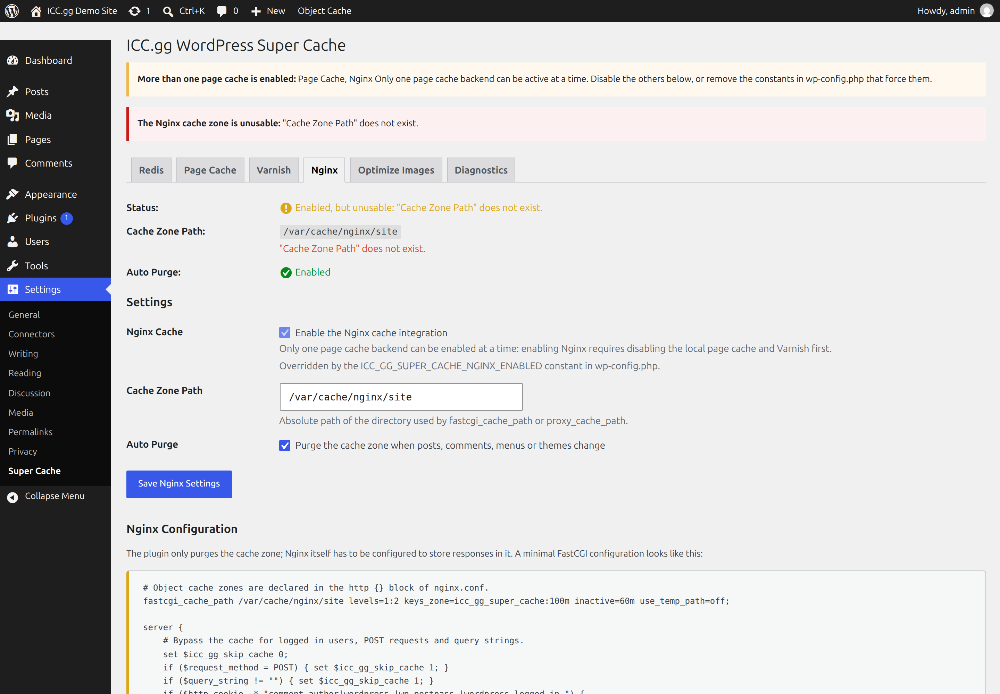
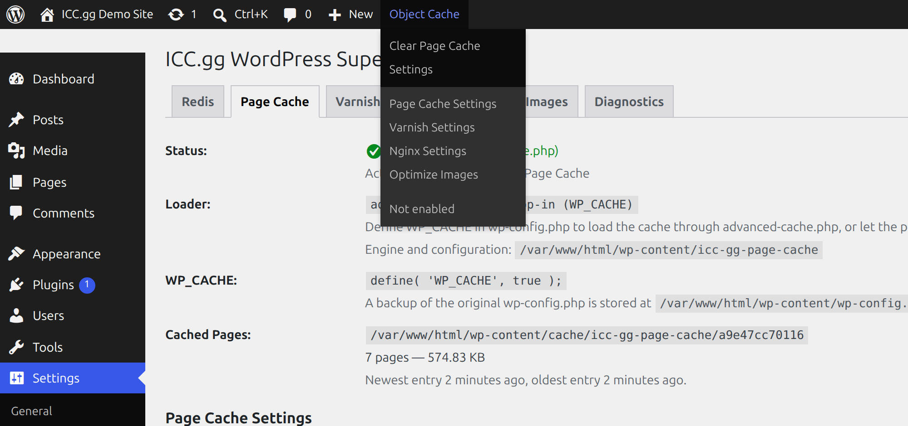

# ICC.gg WordPress Super Cache

A WordPress plugin that provides a persistent object cache backend powered by Redis®¹, three mutually exclusive page cache backends (local PHP page cache, Varnish and Nginx) and a media library image optimizer. It supports Predis, PhpRedis, Relay, replication, sentinels, clustering and WP-CLI.

<!-- buttons -->
[](https://github.com/ivancarlosti/wordpressiccsupercache/stargazers)
[](https://github.com/sponsors/ivancarlosti)
[](https://github.com/sponsors/ivancarlosti)
[](https://github.com/ivancarlosti/wordpressiccsupercache/releases)
[](https://github.com/ivancarlosti/wordpressiccsupercache/pulse)
[](https://github.com/ivancarlosti/wordpressiccsupercache/issues)  
[](LICENSE)
[](https://github.com/ivancarlosti/wordpressiccsupercache/commits)
[](https://github.com/ivancarlosti/wordpressiccsupercache/security)
[](https://github.com/ivancarlosti/wordpressiccsupercache?tab=coc-ov-file)
<!-- endbuttons -->



## Features

- **Redis Object Cache Backend** — A drop-in [`object-cache.php`](includes/object-cache.php:1) replacement that stores WordPress object cache data in Redis
- **Multiple Clients** — Works with [Predis](https://github.com/predis/predis/) (bundled), [PhpRedis (PECL)](https://github.com/phpredis/phpredis) and [Relay](https://relaycache.com)
- **High Availability** — Supports replication, sentinels, clustering and sharding
- **One-Click Management** — Enable, disable, flush and update the object cache drop-in from **Settings → Super Cache**
- **Local Page Cache** — Store pages as static HTML in `wp-content` and serve them before WordPress boots, configured on its own tab with clear cache, purge by URL and preload
- **Varnish Support** — Send `PURGE`/`BAN` requests to a Varnish instance, test the connection and copy the matching VCL snippet
- **Nginx Page Cache** — Purge a FastCGI, Proxy or uWSGI cache zone automatically or manually, configured on its own tab
- **One Page Cache at a Time** — The local, Varnish and Nginx backends are mutually exclusive, so a page can never be cached twice
- **Image Optimizer** — Compress the media library, cap image dimensions and file size, and store new uploads as WebP; formats are detected at runtime
- **Metrics Dashboard** — Track hit ratio, hits, misses, cache size, calls and response time with charts
- **Diagnostics** — Inspect the Redis server, client, connection and key configuration
- **Dashboard Widget** — View cache performance directly from the WordPress dashboard
- **Admin Bar Integration** — See cache status and flush the cache from the admin bar
- **Query Monitor Integration** — Inspect cache activity with the Query Monitor plugin
- **WP-CLI Support** — Enable, disable, update and inspect the object cache from the command line
- **Multisite Support** — Network-aware settings and cache groups
- **Graceful Degradation** — Optionally fall back to the default cache when Redis is unreachable

## Screenshots

Every image below is a real capture of **Settings → Super Cache** on WordPress 7.1.4 with PHP 8.3, six
images in the media library, Varnish 7.5 in front of the site and the local page cache warmed by real
traffic. The files live in [`docs/screenshots`](docs/screenshots), together with
[instructions to regenerate them](docs/screenshots/README.md).

| | |
|---|---|
| **Page Cache** — loader, `WP_CACHE`, cached pages and size, expiry, behaviour, exclusions, clear cache and maintenance<br> | **Varnish** — purge endpoint plus a passing connection test with the headers it received and the VCL snippet to paste<br> |
| **Nginx** — cache zone, auto purge and the FastCGI configuration for the zone<br> | **Optimize Images** — library progress, formats detected at runtime, quality, dimensions, size cap and the batch optimizer<br> |
| **One page cache at a time** — a second backend forced on by a `wp-config.php` constant is reported instead of silently fighting the active one<br> | **Admin bar** — a clear cache action for every enabled backend and a shortcut to each tab<br> |

## Requirements

- WordPress 5.0+
- PHP 8.2+
- A running Redis server (for the Redis module)
- Varnish 4+ (optional, for the Varnish module)
- Nginx with `fastcgi_cache_path` or `proxy_cache_path` (optional, for the Nginx module)
- GD or Imagick (optional, for the image optimizer)
- One of the following clients:
  - [Predis](https://github.com/predis/predis/) (bundled with the plugin)
  - [PhpRedis](https://github.com/phpredis/phpredis) (PECL extension)
  - [Relay](https://relaycache.com) (extension)

## Installation

1. Download the plugin or clone this repository into `/wp-content/plugins/`
2. Activate the plugin through the WordPress admin panel
3. Go to **Settings → Super Cache** to configure and enable the object cache

## Quick Setup

1. Activate the plugin and open **Settings → Super Cache**
2. (Optional) Define your connection settings in `wp-config.php` — see the [Configuration](#configuration) section below
3. Click **Enable Object Cache** to install the `object-cache.php` drop-in
4. Verify the status shows **Connected** in the **Redis** tab
5. (Optional) Open the **Page Cache** tab to enable the local PHP page cache, or the **Varnish** / **Nginx** tabs to enable one of the other page cache backends
6. (Optional) Open the **Optimize Images** tab to compress the media library

The plugin defaults to connecting to `127.0.0.1:6379` with database `0` when no connection constants are defined.

## Configuration

All settings can be defined as PHP constants in `wp-config.php` for added security and CI/CD support.

### Connection

| Constant | Description | Default |
|---|---|---|
| `WP_REDIS_HOST` | The Redis server hostname or IP address | `127.0.0.1` |
| `WP_REDIS_PORT` | The Redis server port | `6379` |
| `WP_REDIS_DATABASE` | The Redis database index | `0` |
| `WP_REDIS_PASSWORD` | The Redis password (optional) | `null` |
| `WP_REDIS_USERNAME` | The Redis ACL username (optional) | `null` |
| `WP_REDIS_SCHEME` | The connection scheme (`tcp`, `unix`, `tls`, `rediss`, etc.) | `tcp` |
| `WP_REDIS_PATH` | The socket path when using a Unix socket | `null` |
| `WP_REDIS_TIMEOUT` | Connection timeout in seconds | `1` |
| `WP_REDIS_READ_TIMEOUT` | Read timeout in seconds | `1` |
| `WP_REDIS_RETRY_INTERVAL` | Retry interval in milliseconds | `null` |

### Replication, Clustering & Sharding

| Constant | Description |
|---|---|
| `WP_REDIS_SERVERS` | Array of servers for replication (e.g., `['tcp://127.0.0.1:6379', 'tcp://127.0.0.1:6380']`) |
| `WP_REDIS_SHARDS` | Array of shard groups for client-side sharding |
| `WP_REDIS_CLUSTER` | Array of cluster nodes for Redis Cluster |
| `WP_REDIS_SENTINEL` | Array of sentinel nodes for high availability |

### Keys & Expiration

| Constant | Description |
|---|---|
| `WP_REDIS_PREFIX` | Key prefix for this site's cache |
| `WP_REDIS_SELECTIVE_FLUSH` | Flush only keys with `WP_REDIS_PREFIX` when set to `true` |
| `WP_REDIS_MAXTTL` | Maximum time-to-live for cache keys, in seconds |

### Groups

| Constant | Description |
|---|---|
| `WP_REDIS_GLOBAL_GROUPS` | Array of groups that are shared across a multisite network |
| `WP_REDIS_IGNORED_GROUPS` | Array of groups that are ignored by Redis |
| `WP_REDIS_UNFLUSHABLE_GROUPS` | Array of groups that are not flushed on `wp_cache_flush()` |

### Behavior

| Constant | Description |
|---|---|
| `WP_REDIS_CLIENT` | Force the Redis client (`predis`, `phpredis` or `relay`) |
| `WP_REDIS_DISABLED` | Disable the object cache entirely when set to `true` |
| `WP_REDIS_GRACEFUL` | Fail gracefully to the default cache when Redis is unreachable |
| `WP_REDIS_DISABLE_DROPIN_BANNERS` | Hide drop-in related admin notices |
| `WP_REDIS_DISABLE_DROPIN_AUTOUPDATE` | Disable automatic drop-in updates |
| `WP_REDIS_DISABLE_DROPIN_CHECK` | Skip filesystem write checks for the drop-in |
| `WP_REDIS_DISABLE_ADMINBAR` | Hide the admin bar menu item |
| `WP_REDIS_DISABLE_COMMENT` | Disable the HTML performance comment in the page source |
| `WP_REDIS_MANAGER_CAPABILITY` | Override the capability required to manage Redis |
| `WP_REDIS_SSL_CONTEXT` | SSL context options for TLS connections |
| `WP_REDIS_FLUSH_TIMEOUT` | Read timeout in seconds used when flushing the cache | `5` |

Example:

```php
define( 'WP_REDIS_HOST', '127.0.0.1' );
define( 'WP_REDIS_PORT', 6379 );
define( 'WP_REDIS_DATABASE', 0 );
define( 'WP_REDIS_PASSWORD', 'your-redis-password' );
define( 'WP_REDIS_CLIENT', 'phpredis' );
define( 'WP_REDIS_PREFIX', 'mysite' );
define( 'WP_REDIS_MAXTTL', 86400 );
define( 'WP_REDIS_GRACEFUL', true );
```

## Nginx Page Cache

The plugin can purge the directory used by Nginx's `fastcgi_cache_path`, `proxy_cache_path` or `uwsgi_cache_path`. The module is fully independent from the Redis object cache: it can be enabled on its own, configured on the **Nginx** tab and purged manually at any time.

### Nginx constants

| Constant | Description | Default |
|---|---|---|
| `ICC_GG_SUPER_CACHE_NGINX_ENABLED` | Force the Nginx module on or off | Stored setting |
| `ICC_GG_SUPER_CACHE_NGINX_PATH` | Absolute path of the cache zone directory | Stored setting |
| `ICC_GG_SUPER_CACHE_NGINX_AUTO_PURGE` | Purge the zone automatically when content changes | Stored setting |
| `NGINX_CACHE_PATH` | Legacy alias for the cache zone path | — |

Example:

```php
define( 'ICC_GG_SUPER_CACHE_NGINX_ENABLED', true );
define( 'ICC_GG_SUPER_CACHE_NGINX_PATH', '/var/cache/nginx/example.com' );
define( 'ICC_GG_SUPER_CACHE_NGINX_AUTO_PURGE', true );
```

### Settings form

All three values can also be changed on the **Nginx** tab, which additionally shows the current status, the number of cached files and the cache size. Values defined as constants take precedence and the matching form field is disabled.

### Nginx configuration

The plugin only empties the cache zone; Nginx must be configured to store responses in it:

```nginx
# http {} block
fastcgi_cache_path /var/cache/nginx/example.com levels=1:2 keys_zone=icc_gg_super_cache:100m inactive=60m use_temp_path=off;

server {
    set $icc_gg_skip_cache 0;
    if ($request_method = POST) { set $icc_gg_skip_cache 1; }
    if ($query_string != "") { set $icc_gg_skip_cache 1; }
    if ($http_cookie ~* "comment_author|wordpress_|wp-postpass_|wordpress_logged_in_") {
        set $icc_gg_skip_cache 1;
    }

    location ~ \.php$ {
        fastcgi_cache icc_gg_super_cache;
        fastcgi_cache_key "$scheme$request_method$host$request_uri";
        fastcgi_cache_valid 200 301 302 60m;
        fastcgi_cache_bypass $icc_gg_skip_cache;
        fastcgi_no_cache $icc_gg_skip_cache;
        add_header X-FastCGI-Cache $upstream_cache_status;
    }
}
```

Automatic purges run on `save_post`, `edit_post`, `delete_post`, `wp_trash_post`, `clean_post_cache`, comment and trackback actions, `switch_theme`, `wp_update_nav_menu` and `edit_user_profile_update`. Post types can be excluded with the `icc_gg_wordpress_super_cache_nginx_excluded_post_types` filter.

## Page Cache Backends

The plugin ships three page cache backends and only one of them can be enabled at a time:

| Backend | Tab | What it does |
|---|---|---|
| Local PHP page cache | **Page Cache** | Serves cached HTML from `wp-content` before WordPress boots |
| Varnish | **Varnish** | Purges an HTTP cache in front of the site with `PURGE` or `BAN` |
| Nginx | **Nginx** | Purges a `fastcgi_cache_path`, `proxy_cache_path` or `uwsgi_cache_path` zone |

See the [screenshots](#screenshots) for what each tab looks like once it is enabled.

Every page cache tab shows its own status, its own settings and its own clear cache action, and the admin
bar grows a **Clear Page Cache** / **Purge Varnish Cache** / **Purge Nginx Cache** entry for each backend
that is enabled. Trying to enable a second backend is rejected with a message naming the backend that is
already active — nothing is ever disabled behind your back.

Advanced setups that intentionally run Varnish in front of Nginx can lift the rule:

```php
add_filter( 'icc_gg_wordpress_super_cache_page_cache_exclusive', '__return_false' );
```

The active backend is stored in the `icc_gg_wordpress_super_cache_page_cache` option and can be forced
with `ICC_GG_SUPER_CACHE_PAGE_CACHE` (`local`, `varnish` or `nginx`).

### Local page cache

Enabling the local page cache writes a standalone engine plus a compiled `config.php` into
`wp-content/icc-gg-page-cache/` and installs one of two loaders:

- `wp-content/advanced-cache.php`, used when `WP_CACHE` is defined. The plugin adds
  `define( 'WP_CACHE', true );` to `wp-config.php` when that is safe: it backs the file up to
  `wp-content/wp-config.icc-gg-backup.php`, writes a temporary file, verifies it and only then replaces
  the original. The **Revert wp-config.php Backup** button restores it.
- `wp-content/mu-plugins/icc-gg-page-cache.php`, installed when `wp-config.php` cannot be edited
  (read-only file, `DISALLOW_FILE_MODS`, non-standard `WP_CONTENT_DIR` or
  `ICC_GG_SUPER_CACHE_ALLOW_WP_CONFIG_EDIT = false`). It cannot fatal when the plugin is deleted.

Cached pages live in `wp-content/cache/icc-gg-page-cache/<secret>/<host>/…` as `index.html` plus an
optional `index.html.gz`. Logged-in users, commenters, password protected posts, feeds, searches, 404s,
the REST API and the customizer are never cached, and responses that set cookies or are not `200 text/html`
are skipped. See [docs/page-cache.md](docs/page-cache.md) for the settings, exclusions, preloading and
constants.

```php
define( 'ICC_GG_SUPER_CACHE_LOCAL_ENABLED', true );
define( 'ICC_GG_SUPER_CACHE_LOCAL_AUTO_PURGE', true );
define( 'ICC_GG_SUPER_CACHE_ALLOW_WP_CONFIG_EDIT', false ); // always use the must-use plugin loader
```

### Varnish

The **Varnish** tab configures the purge endpoint (host, port, scheme, timeout), the purge method
(`PURGE` for a single URL, `BAN` for Varnish 4+ patterns), an optional `X-Purge-Key` and automatic
purging. **Test Connection** probes the home page for `X-Varnish`, `Via`, `Age` and `X-Cache` headers and
sends a purge request, and the tab renders the VCL snippet that accepts those requests. See
[docs/varnish.md](docs/varnish.md).

```php
define( 'ICC_GG_SUPER_CACHE_VARNISH_ENABLED', true );
define( 'ICC_GG_SUPER_CACHE_VARNISH_HOST', '127.0.0.1' );
define( 'ICC_GG_SUPER_CACHE_VARNISH_PORT', 6081 );
define( 'ICC_GG_SUPER_CACHE_VARNISH_KEY', 'change-me' );
```

## Image Optimizer

The **Optimize Images** tab compresses the media library in batches, caps image dimensions and file size,
keeps a backup of every original in `wp-content/icc-gg-image-backups` and can store new JPEG/PNG uploads
as WebP. Formats are discovered at runtime with `wp_image_editor_supports()`, so a server without WebP or
AVIF support simply does not offer them. See [docs/image-optimizer.md](docs/image-optimizer.md) and the
[screenshot](#screenshots) of a half optimized library.

## WP-CLI

The plugin registers the `icc-gg-wordpress-super-cache` command:

```bash
wp icc-gg-wordpress-super-cache status
wp icc-gg-wordpress-super-cache enable
wp icc-gg-wordpress-super-cache disable
wp icc-gg-wordpress-super-cache update-dropin
wp icc-gg-wordpress-super-cache page-cache-status
wp icc-gg-wordpress-super-cache page-cache-enable
wp icc-gg-wordpress-super-cache page-cache-disable
wp icc-gg-wordpress-super-cache page-cache-purge
wp icc-gg-wordpress-super-cache page-cache-purge /about/ '/blog/*'
wp icc-gg-wordpress-super-cache page-cache-preload
wp icc-gg-wordpress-super-cache varnish-status
wp icc-gg-wordpress-super-cache varnish-test
wp icc-gg-wordpress-super-cache varnish-purge
wp icc-gg-wordpress-super-cache images-optimize --limit=10
wp icc-gg-wordpress-super-cache nginx-status
wp icc-gg-wordpress-super-cache nginx-purge
```

To flush the cache from the command line, use the built-in `wp cache flush` command.

## Hooks & Filters

The plugin provides actions and filters for customization. See [`object-cache.php`](includes/object-cache.php:1) for the complete list including:

**Actions**

- `icc_gg_wordpress_super_cache_enable` — Fired after the object cache is enabled
- `icc_gg_wordpress_super_cache_disable` — Fired after the object cache is disabled
- `icc_gg_wordpress_super_cache_update_dropin` — Fired after the drop-in is updated
- `icc_gg_wordpress_super_cache_delete` — Fired when a key is deleted
- `icc_gg_wordpress_super_cache_get` — Fired when a key is retrieved
- `icc_gg_wordpress_super_cache_get_multiple` — Fired when multiple keys are retrieved
- `icc_gg_wordpress_super_cache_set` — Fired when a key is stored
- `icc_gg_wordpress_super_cache_flush` — Fired when the cache is flushed
- `icc_gg_wordpress_super_cache_flush_group` — Fired when a cache group is flushed
- `icc_gg_wordpress_super_cache_error` — Fired when an error occurs
- `icc_gg_wordpress_super_cache_nginx_cache_purged` — Fired after the Nginx cache zone was purged

**Page cache, Varnish and image optimizer actions**

- `icc_gg_wordpress_super_cache_page_cache_changed` — Fired after a page cache backend is enabled or disabled (`$active`, `$backend`, `$enabled`)
- `icc_gg_wordpress_super_cache_local_cache_purged` — Fired after the local page cache was purged
- `icc_gg_wordpress_super_cache_varnish_purged` — Fired after a Varnish purge request was accepted (`$url`, `$method`)

**Filters**

- `icc_gg_wordpress_super_cache_expiration` — Modify the expiration of a cache key
- `icc_gg_wordpress_super_cache_get_value` — Modify a value before it is returned
- `icc_gg_wordpress_super_cache_add_non_persistent_groups` — Modify non-persistent groups
- `icc_gg_wordpress_super_cache_validate_dropin` — Modify the drop-in validation state
- `icc_gg_wordpress_super_cache_manager_capability` — Modify the capability required to manage Redis
- `icc_gg_wordpress_super_cache_nginx_purge_actions` — Modify the hooks that trigger an automatic Nginx cache purge
- `icc_gg_wordpress_super_cache_nginx_excluded_post_types` — Exclude post types from triggering an Nginx cache purge
- `icc_gg_wordpress_super_cache_page_cache_exclusive` — Return `false` to allow several page cache backends at once
- `icc_gg_wordpress_super_cache_page_cache_backends` — Modify the registered page cache backends (`slug => label`)
- `icc_gg_wordpress_super_cache_page_cache_purge_actions` — Modify the hooks that trigger a page cache purge
- `icc_gg_wordpress_super_cache_local_cache_config` — Modify the configuration compiled for the page cache engine
- `icc_gg_wordpress_super_cache_local_preload_urls` — Modify the URLs queued for preloading
- `icc_gg_wordpress_super_cache_preload_sslverify` — Disable SSL verification for preload requests
- `icc_gg_wordpress_super_cache_varnish_sslverify` — Disable SSL verification for Varnish probe and purge requests
- `icc_gg_wordpress_super_cache_image_optimizer_mimes` — Modify the image formats offered by the optimizer

## Troubleshooting

Answers to common questions and troubleshooting of common errors can be found in the upstream [Redis Object Cache FAQ](https://github.com/rhubarbgroup/redis-cache/blob/develop/FAQ.md).

¹ Redis is a registered trademark of Redis Ltd. Any rights therein are reserved to Redis Ltd. Any use by ICC.gg WordPress Super Cache is for referential purposes only and does not indicate any sponsorship, endorsement or affiliation between Redis and ICC.gg WordPress Super Cache.

## Credits

**ICC.gg WordPress Super Cache** is maintained by [Ivan Carlos](https://github.com/ivancarlosti).

This plugin is a fork of [Redis Object Cache](https://github.com/rhubarbgroup/redis-cache).

The Nginx page cache module is derived from the [Nginx Cache](https://wordpress.org/plugins/nginx-cache/) plugin by [Till Krüss](https://till.im), released under the GPLv3.

<!-- footer -->
---

## 🧑‍💻 Consulting and technical support
* For personal support and queries, please submit a new issue to have it addressed.
* For commercial related questions, please [**contact me**][ivancarlos] for consulting costs.

[cc]: https://docs.github.com/en/communities/setting-up-your-project-for-healthy-contributions/adding-a-code-of-conduct-to-your-project
[contributing]: https://docs.github.com/en/articles/setting-guidelines-for-repository-contributors
[security]: https://docs.github.com/en/code-security/getting-started/adding-a-security-policy-to-your-repository
[support]: https://docs.github.com/en/articles/adding-support-resources-to-your-project
[it]: https://docs.github.com/en/communities/using-templates-to-encourage-useful-issues-and-pull-requests/configuring-issue-templates-for-your-repository#configuring-the-template-chooser
[prt]: https://docs.github.com/en/communities/using-templates-to-encourage-useful-issues-and-pull-requests/creating-a-pull-request-template-for-your-repository
[funding]: https://docs.github.com/en/articles/displaying-a-sponsor-button-in-your-repository
[ivancarlos]: https://ivancarlos.me
