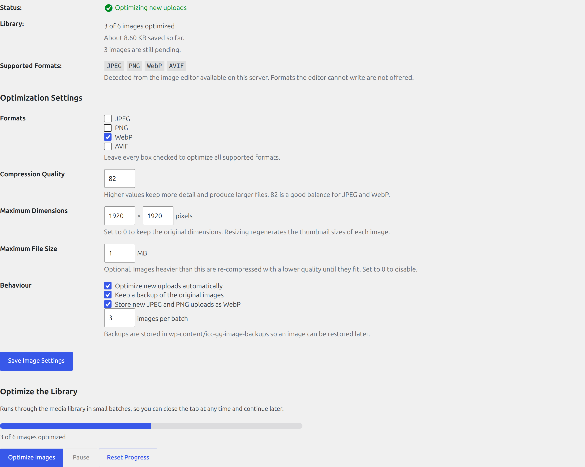

# Image optimizer

The **Optimize Images** tab compresses the media library, optionally caps image dimensions and file
size, and can store new uploads as WebP.



## Supported formats

Formats are discovered at runtime: the plugin lists every candidate mime type that WordPress knows
(`wp_get_mime_types()`) **and** that the available image editor can write (`wp_image_editor_supports()`).
On a stock GD build without WebP support only JPEG and PNG are offered; a build with Imagick or
libwebp also offers WebP, and WordPress 6.1+ may add AVIF.

Animated GIFs are intentionally not optimized because resizing or re-encoding them drops animation
frames.

## Settings

| Setting | Description |
|---|---|
| Formats | Mime types to process. All boxes checked means "all supported formats". |
| Compression Quality | 30–100, applied to JPEG, WebP and AVIF (PNG uses the same value as compression level) |
| Maximum Dimensions | Cap width and height in pixels. `0` keeps the original size. |
| Maximum File Size | Optional target weight in MB. Heavier files are re-compressed with a lower quality. |
| Optimize new uploads automatically | Runs the optimizer on `wp_generate_attachment_metadata` |
| Keep a backup of the original images | Copies the original to `wp-content/icc-gg-image-backups` |
| Store new JPEG and PNG uploads as WebP | Adds an `image_editor_output_format` mapping |
| Images per batch | 1–20, used by the AJAX runner and by WP-CLI |

## What happens to an image

1. The attachment file is opened with `wp_get_image_editor()`.
2. When a maximum dimension is set and the image is larger, it is resized proportionally.
3. The file is saved with the configured quality.
4. When a target file size is set, the quality is lowered in steps of 10 (never below 40) up to four
   times until the file fits.
5. When the dimensions changed, `wp_create_image_subsizes()` regenerates the thumbnail sizes and the
   attachment metadata is updated.
6. The result is stored in the `_icc_gg_image_optimizer` post meta: original and optimized byte counts,
   quality, dimensions, backup path and timestamp.

## Batch processing

The tab runs the optimizer through `admin-ajax.php` in small batches, with a progress bar, a **Pause**
button and a **Reset Progress** action. Each batch returns the number of processed, failed and pending
images plus the aggregated statistics.

Failures are recorded in the post meta (with an `error` key) and in the batch state, so a broken file is
never retried on every run. Pending images are selected with a `NOT EXISTS` meta query on
`_icc_gg_image_optimizer`.

## Backups and restoring

Backups mirror the uploads structure:

```
wp-content/uploads/2026/05/photo.jpg
wp-content/icc-gg-image-backups/2026/05/photo.jpg
```

`ICC_GG_WordPress_Super_Cache_Image_Optimizer::restore_attachment( $id )` copies the backup back over the
attachment, deletes the post meta, regenerates the sub-sizes and removes the backup file.

## WP-CLI

```bash
wp icc-gg-wordpress-super-cache images-optimize --limit=10
wp icc-gg-wordpress-super-cache images-optimize --loop
```

## Notes

- **Resizing is destructive.** Keep backups enabled (the default) or download the originals first.
- WebP conversion only applies to **new** uploads. Existing files keep their format; the batch optimizer
  re-encodes them at the configured quality instead of converting them.
- Shared hosting CPU limits are the usual bottleneck: keep the batch size small and let the AJAX runner
  work through the library in the background.
- The optimizer respects the `icc_gg_wordpress_super_cache_image_optimizer_mimes` filter, which can be
  used to hide a format the editor claims to support but encodes badly.
