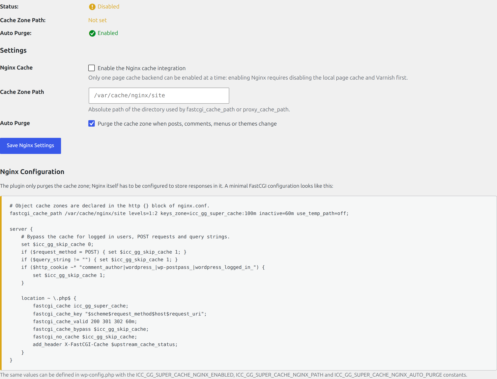

# nginx FastCGI

The nginx FastCGI backend purges a `fastcgi_cache` zone that serves the PHP responses of the site. The
plugin does not talk to nginx over HTTP: it walks the cache zone directory and removes the entries, so no
extra `PURGE` endpoint is required.



## Settings

| Setting | Description |
|---|---|
| nginx FastCGI Cache | Enable the backend (mutually exclusive with the local page cache and Varnish Cache) |
| Cache Zone Path | Absolute path used by `fastcgi_cache_path` (or `proxy_cache_path`), for example `/var/cache/nginx/site` |
| Auto Purge | Purge the zone when posts, comments, menus or themes change |

The path must be readable and writable by the PHP user; the tab reports *The nginx FastCGI cache zone is
unusable* with the reason when it is not.

## Example configuration

```nginx
# Declared in the http {} block of nginx.conf.
fastcgi_cache_path /var/cache/nginx/site levels=1:2 keys_zone=icc_gg_super_cache:100m
                   inactive=60m use_temp_path=off;

server {
    # Bypass the cache for logged in users, POST requests and query strings.
    set $icc_gg_skip_cache 0;
    if ($request_method = POST) { set $icc_gg_skip_cache 1; }
    if ($query_string != "") { set $icc_gg_skip_cache 1; }
    if ($http_cookie ~* "comment_author|wordpress_|wp-postpass_|wordpress_logged_in_") {
        set $icc_gg_skip_cache 1;
    }

    # The URL exclusions from the Page Cache tab, repeated for nginx.
    if ($request_uri ~* "^/wp-admin") { set $icc_gg_skip_cache 1; }
    if ($request_uri ~* "^/wp-login\.php") { set $icc_gg_skip_cache 1; }
    if ($request_uri ~* "^/wp-json") { set $icc_gg_skip_cache 1; }

    location ~ \.php$ {
        fastcgi_cache icc_gg_super_cache;
        fastcgi_cache_key "$scheme$request_method$host$request_uri";
        fastcgi_cache_valid 200 301 302 60m;
        fastcgi_cache_bypass $icc_gg_skip_cache;
        fastcgi_no_cache $icc_gg_skip_cache;
        add_header X-FastCGI-Cache $upstream_cache_status;
    }
}
```

The tab renders the same block with the configured path and the *current* exclusions already expanded, so
copy it from there instead of typing it.

## Exclusions

nginx answers before WordPress runs, so the URL exclusions of the local page cache have no effect on a
FastCGI cache. `Local_Cache::exclusion_regexes()` compiles the list into PCRE patterns and the tab
generates one `if ($request_uri ~* "...") { set $icc_gg_skip_cache 1; }` line per pattern; update the
server block whenever the exclusion list changes.

Purging ignores the exclusions on purpose: it removes whatever the zone contains, which is what makes
**Clear Page Cache** equivalent to a full flush for this backend.

`$request_uri` includes the query string, so a pattern such as `/?s=*` becomes `^/\?s=.*` and matches
`/?s=term`.

## Constants

| Constant | Description |
|---|---|
| `ICC_GG_SUPER_CACHE_NGINX_ENABLED` | Force the nginx FastCGI backend on or off |
| `ICC_GG_SUPER_CACHE_NGINX_AUTO_PURGE` | Force automatic purges on or off |
| `ICC_GG_SUPER_CACHE_NGINX_PATH` | Cache zone path |
| `NGINX_CACHE_PATH` | Legacy alias for the cache zone path |

## Filters

| Filter | Description |
|---|---|
| `icc_gg_wordpress_super_cache_nginx_excluded_post_types` | Post types excluded from automatic purges |
| `icc_gg_wordpress_super_cache_page_cache_backends` | Backend labels (`slug => label`) |

## WP-CLI

```bash
wp icc-gg-wordpress-super-cache nginx-status
wp icc-gg-wordpress-super-cache nginx-purge
```

## Notes

- The plugin only purges. Storing responses is nginx's job: without `fastcgi_cache` in the PHP location
  the zone stays empty and purges report *skipped*.
- Purges run with the PHP user, so it needs read and write access to the zone; group ownership with the
  nginx worker user is usually enough.
- `proxy_cache_path` zones work the same way, as long as the path points at the zone directory and the
  purge runs on the same server.
- Varnish in front of nginx keeps serving stale pages after an nginx purge; purge both, or lift the
  mutual exclusion with the `icc_gg_wordpress_super_cache_page_cache_exclusive` filter.
