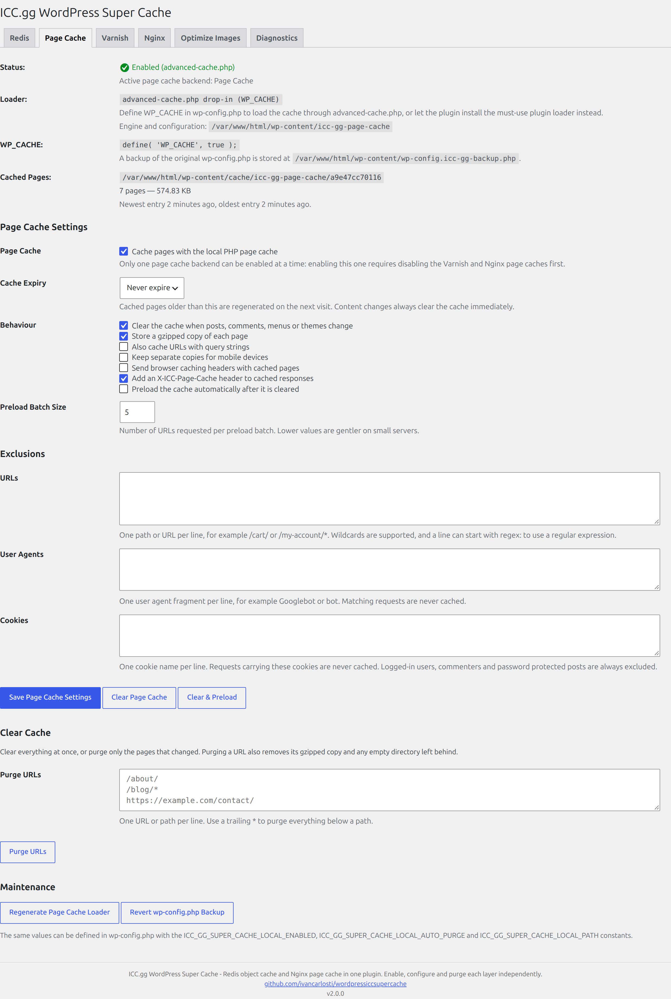

# Local page cache

The local page cache stores the HTML of cacheable requests inside `wp-content` and serves it before
WordPress boots, so a cached page never runs a single query.



## Files

| Path | Purpose |
|---|---|
| `wp-content/icc-gg-page-cache/engine.php` | Copy of `includes/local-cache-engine.php` |
| `wp-content/icc-gg-page-cache/config.php` | Compiled settings, rewritten on every save |
| `wp-content/advanced-cache.php` | Loader used when `WP_CACHE` is defined |
| `wp-content/advanced-cache.icc-gg-backup.php` | Copy of the `advanced-cache.php` replaced by **Write / Rewrite** |
| `wp-content/mu-plugins/icc-gg-page-cache.php` | Loader used when `wp-config.php` cannot be edited |
| `wp-content/cache/icc-gg-page-cache/<secret>/<host>/…/index.html` | Cached pages, plus a `.gz` copy |
| `wp-content/wp-config.icc-gg-backup.php` | Backup created before editing `wp-config.php` |

Only one loader is installed at a time. Both define `ICC_GG_PAGE_CACHE_HANDLED` before loading the
engine, so they can never run twice.

## Enabling

Enabling the page cache from the **Page Cache** tab:

1. Registers the backend as active (mutual exclusion applies).
2. Writes `engine.php` and `config.php` into `wp-content/icc-gg-page-cache/`.
3. Adds `define( 'WP_CACHE', true );` to `wp-config.php` when all of these are true:
   - `ICC_GG_SUPER_CACHE_ALLOW_WP_CONFIG_EDIT` is not `false`,
   - `is_file_mod_allowed()` agrees (no `DISALLOW_FILE_MODS`),
   - `WP_CONTENT_DIR` is the standard `ABSPATH . 'wp-content'`,
   - `wp-config.php` is writable,
   - the anchor (`/* That's all, stop editing! Happy publishing. */` or the `wp-settings.php` require)
     can be located.
4. Installs `advanced-cache.php` when the constant is in place, otherwise the must-use plugin loader.

The edit is written to a temporary file, renamed over the original, and verified by reading it back. If
verification fails the backup is restored automatically. The **Revert wp-config.php Backup** button
restores the original file at any time; the page cache keeps working through the must-use plugin loader.

## Writing or rewriting the loader

Enabling the page cache never overwrites a loader owned by another plugin: `install()` returns a
`foreign_dropin` error and leaves the file alone. The **Maintenance** section has two buttons:

| Button | Behaviour |
|---|---|
| **Regenerate Page Cache Loader** | Rewrites `engine.php`/`config.php` and refreshes the loader **only when it already belongs to this plugin**. Refuses foreign files. |
| **Write / Rewrite advanced-cache.php** | Writes the loader even when the file is missing, damaged, outdated or owned by another plugin. |

**Write / Rewrite** backs the existing file up to `wp-content/advanced-cache.icc-gg-backup.php` (skipped
when the file already matches what would be written), writes the replacement through the filesystem API
and then removes the loader that is no longer used. When `WP_CACHE` cannot be added to `wp-config.php`
it writes the must-use plugin loader instead.

The **Status** table reports the state of every loader so the reason is never a guess:

| State | Meaning |
|---|---|
| Not installed | File absent |
| Up to date | Header *and* contents match the current template |
| Outdated, needs rewriting | Our header, older version |
| Damaged or unreadable | Our header, but the contents differ from the template (partial upload, merge conflict) |
| Installed by another plugin | Foreign header — nothing is touched automatically |

`loader_state()`, `dropin_is_valid()`, `mu_plugin_is_valid()` and `loaders_are_stale()` expose the same
information to code. Our own damaged loaders are also rewritten automatically on `admin_init`.

## Settings

| Setting | Description |
|---|---|
| Page Cache | Enable the backend (mutually exclusive with Varnish Cache and nginx FastCGI) |
| Cache Expiry | `Never`, 1 hour, 6 hours, 12 hours, 24 hours or 1 week |
| Clear the cache when content changes | Automatic purges on post, comment, menu and theme changes |
| Gzipped copy | Store `index.html.gz` next to the HTML file |
| URLs with query strings | Cache `?foo=bar` requests (hashed into the path) |
| Separate mobile copies | Append `-mobile` to the host directory for mobile user agents |
| Browser caching headers | Send `Cache-Control`/`Expires` for the configured expiry |
| `X-ICC-Page-Cache` header | Report `HIT` on cached responses |
| Preload after clear | Queue every public URL after a purge |
| Preload batch size | URLs requested per preload batch (1–50) |

## Exclusions

Three textareas, one entry per line:

- **URLs** — paths or full URLs, `*` wildcards, or a line starting with `regex:`.
- **User agents** — matched case-insensitively against `HTTP_USER_AGENT`.
- **Cookies** — a request carrying any of these cookies is never cached.

The URL list ships prefilled with the WordPress paths that should never be cached, so the effective
configuration is visible instead of hidden in code. Existing installations get the missing lines added
once (nothing is removed); **Restore default exclusions** replaces the list with the defaults.

```
/wp-admin
/wp-admin/*
/wp-login.php
/wp-json
/wp-json/*
/wp-cron.php
/xmlrpc.php
/wp-comments-post.php
/wp-signup.php
/wp-activate.php
/wp-trackback.php
/wp-sitemap.xml
/feed/*
/comments/feed/*
/?s=*
```

`/wp-admin` and `/wp-admin/*` are both needed: patterns are anchored with `^`, and `/wp-admin` alone
does not match `/wp-admin/options-general.php`. The same lock is what the engine enforces, so removing a
line does not re-enable caching for that path.

These exclusions belong to this local page cache only. Varnish Cache and nginx FastCGI answer before
PHP runs, so they need the same paths in their own configuration: `exclusion_regexes()` compiles the
list into PCRE patterns and the snippets on those tabs are generated from it
(see [varnish.md](varnish.md) and [nginx.md](nginx.md)). Plain paths are anchored with `^` and `*`
becomes `.*`; a `regex:` line is inserted verbatim (backslashes included), so it has to be valid PCRE for
both Varnish and nginx.

Regardless of the settings, the engine never caches:

- anything but `GET`/`HEAD`,
- requests with a query string (unless enabled),
- `/wp-admin`, `/wp-login.php`, `/wp-json`, `wp-cron.php`, `xmlrpc.php`, feeds and trackbacks,
- requests with WordPress login, comment, password or WooCommerce/EDD session cookies,
- admin, AJAX, REST, cron, WP-CLI or customizer requests,
- logged-in users, 404s, searches, previews and password protected posts,
- responses that set cookies, redirect (non-200) or are not `text/html`,
- responses that contain `<!-- icc-gg-page-cache:no -->` or `DONOTCACHEPAGE`.

## Clear cache

- **Clear Page Cache** empties the cache directory and recreates it.
- **Purge URLs** removes the listed URLs (and their `.gz` copy); a trailing `*` removes everything below
  that path.
- **Clear & Preload** purges and queues every public URL.
- The admin bar shows **Clear Page Cache** while the backend is enabled.

## Preloading

`start_preload()` collects the home page, up to 500 public posts (excluding attachments) and up to 100
category/tag archives, stores them in `icc_gg_wordpress_super_cache_local_preload_queue` and schedules
`icc_gg_wordpress_super_cache_local_preload`. Each cron run sends a non-blocking loopback request per
queued URL and reschedules itself until the queue is empty. `wp cron event run --due-now` speeds this up
on low-traffic sites.

## Constants

| Constant | Description |
|---|---|
| `ICC_GG_SUPER_CACHE_PAGE_CACHE` | Force the active backend: `local`, `varnish` or `nginx` |
| `ICC_GG_SUPER_CACHE_LOCAL_ENABLED` | Force the local page cache on or off |
| `ICC_GG_SUPER_CACHE_LOCAL_AUTO_PURGE` | Force automatic purges on or off |
| `ICC_GG_SUPER_CACHE_LOCAL_PATH` | Cache directory (defaults to `wp-content/cache/icc-gg-page-cache`) |
| `ICC_GG_SUPER_CACHE_ALLOW_WP_CONFIG_EDIT` | `false` disables every `wp-config.php` edit |
| `ICC_GG_SUPER_CACHE_DISABLE_PAGE_CACHE` | `true` stops the must-use plugin loader from booting |

## Filters

| Filter | Description |
|---|---|
| `icc_gg_wordpress_super_cache_page_cache_exclusive` | Return `false` to allow several page caches at once |
| `icc_gg_wordpress_super_cache_local_cache_config` | Engine configuration before it is compiled |
| `icc_gg_wordpress_super_cache_local_default_exclude_urls` | Patterns used as defaults and restored by **Restore default exclusions** |
| `icc_gg_wordpress_super_cache_local_preload_urls` | URLs queued for preloading |
| `icc_gg_wordpress_super_cache_preload_sslverify` | SSL verification for preload requests |
| `icc_gg_wordpress_super_cache_page_cache_purge_actions` | Hooks that trigger automatic purges |
| `icc_gg_wordpress_super_cache_page_cache_backends` | Registered backends (`slug => label`) |

## WP-CLI

```bash
wp icc-gg-wordpress-super-cache page-cache-status
wp icc-gg-wordpress-super-cache page-cache-enable
wp icc-gg-wordpress-super-cache page-cache-disable
wp icc-gg-wordpress-super-cache page-cache-purge
wp icc-gg-wordpress-super-cache page-cache-purge /about/ '/blog/*'
wp icc-gg-wordpress-super-cache page-cache-preload
```
