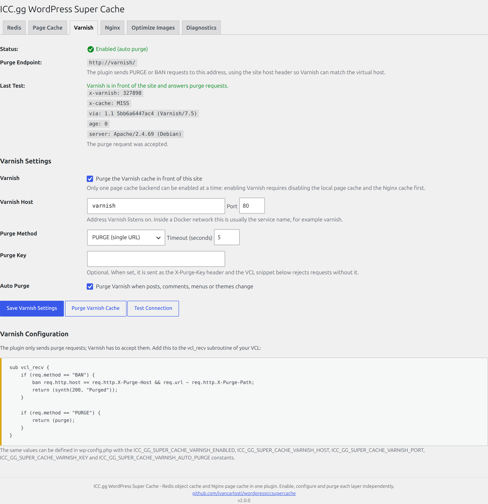

# Varnish Cache

The Varnish Cache backend purges an HTTP cache sitting in front of WordPress. The plugin never configures
Varnish itself: it sends purge requests and shows the VCL snippets that accept them.



## Settings

| Setting | Description |
|---|---|
| Varnish Cache | Enable the backend (mutually exclusive with the local page cache and nginx FastCGI) |
| Varnish Host | Address Varnish listens on (`127.0.0.1`, a Docker service name, …) |
| Port | Port Varnish listens on (default `6081`) |
| Purge Method | `PURGE` for a single URL, `BAN` for Varnish 4+ pattern bans |
| Timeout | Request timeout in seconds |
| Purge Key | Optional shared secret, sent as `X-Purge-Key` |
| Auto Purge | Purge when posts, comments, menus or themes change |

## Purge requests

```
PURGE http://127.0.0.1:6081/about/
Host: example.com
X-Purge-Method: default
X-Purge-Host: example.com
X-Purge-Path: /about/
X-Purge-Key: <key>            # only when configured
User-Agent: ICC.gg Varnish Purge/1.0; https://example.com/
```

`Host` is the site host, not the Varnish address, so the VCL can match the virtual host. With the `BAN`
method the same headers are sent with `X-Purge-Method: regex`.

## Detection and test

**Test Connection** does two things:

1. Requests the home page with a cache buster and looks for `X-Varnish`, `X-Varnish-Cache`,
   `Via: … varnish`, `Age` and `X-Cache` response headers.
2. Sends a purge request to the configured endpoint.

The results are shown on the **Varnish** tab (probe headers and purge response) and stored in a
transient so they survive the redirect that follows the action.

## VCL

The tab renders a snippet for the `vcl_recv` subroutine, including the key check when a key is set:

```vcl
sub vcl_recv {
    if (req.method == "BAN") {
        if (req.http.X-Purge-Key != "secret") {
            return (synth(403, "Forbidden"));
        }
        ban("req.http.host == " + req.http.X-Purge-Host + " && req.url ~ " + req.http.X-Purge-Path);
        return (synth(200, "Purged"));
    }

    if (req.method == "PURGE") {
        if (req.http.X-Purge-Key != "secret") {
            return (synth(403, "Forbidden"));
        }
        return (purge);
    }
}
```

## Exclusions

Varnish answers before WordPress runs, so the URL exclusions of the local page cache never reach it: a
cached `/cart/` would keep being served, and a logged-in visitor could receive a page from the shared
cache. The tab renders a second snippet, generated from the saved exclusions, that must be merged into
the **same** `vcl_recv` subroutine and evaluated before the lookups:

```vcl
sub vcl_recv {
    if (req.method != "GET" && req.method != "HEAD"
        && req.method != "PURGE" && req.method != "BAN") {
        return (pass);
    }

    if (req.http.Authorization) {
        return (pass);
    }

    # The URL exclusions from the Page Cache tab.
    if (req.url ~ "^/wp-admin|^/wp-login\.php|^/wp-json|^/wp-cron\.php") {
        return (pass);
    }

    # Never cache a request carrying a WordPress session or comment cookie.
    if (req.http.Cookie ~ "wordpress_logged_in|comment_author|wp-postpass") {
        return (pass);
    }
}
```

Notes:

- `PURGE`/`BAN` are whitelisted in the method check, otherwise the first rule would swallow the purge
  requests the plugin sends.
- `req.url` keeps the query string, so `/?s=*` becomes `^\?s=.*`-style matching through the same
  compiler (`Local_Cache::exclusion_regexes()`) used by the nginx FastCGI tab.
- Merging two `sub vcl_recv` blocks is a VCL error: copy the `if` blocks into the existing subroutine.
- PURGE and BAN remove whatever Varnish stored, exclusions included; re-cache happens on the next visit.

## Constants

| Constant | Description |
|---|---|
| `ICC_GG_SUPER_CACHE_VARNISH_ENABLED` | Force Varnish on or off |
| `ICC_GG_SUPER_CACHE_VARNISH_AUTO_PURGE` | Force automatic purges on or off |
| `ICC_GG_SUPER_CACHE_VARNISH_HOST` | Purge endpoint host |
| `ICC_GG_SUPER_CACHE_VARNISH_PORT` | Purge endpoint port |
| `ICC_GG_SUPER_CACHE_VARNISH_KEY` | Shared purge key |

## Filters

| Filter | Description |
|---|---|
| `icc_gg_wordpress_super_cache_varnish_sslverify` | SSL verification for probe and purge requests |

## WP-CLI

```bash
wp icc-gg-wordpress-super-cache varnish-status
wp icc-gg-wordpress-super-cache varnish-test
wp icc-gg-wordpress-super-cache varnish-purge
wp icc-gg-wordpress-super-cache varnish-purge /about/
```

## Notes

- Varnish normally sits in front of nginx, so a site that runs both layers on purpose can lift the
  mutual exclusion with the `icc_gg_wordpress_super_cache_page_cache_exclusive` filter.
- Purging only removes objects Varnish knows about. If the VCL ignores cookies, logged-in users may
  receive cached pages; add the usual `Cookie`/`Authorization` bypass rules to your VCL — the
  **Exclusions** snippet above already does it.
- Purging never filters by path: a `BAN` with an empty path removes every object of the host. Keep the
  exclusion list in VCL, not in the purge request.
- `BAN` requires Varnish 4 or newer. Varnish 3 only supports `PURGE`.
